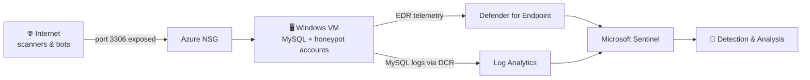

# 🛡️ Incident Response Lab: Catching a MySQL Attack on Azure

> I built a deliberately vulnerable database server in Azure, let the internet find it, then detected, investigated, contained, and cleaned up the attack, following the **NIST SP 800-61** incident response framework.


---

## 📌 TL;DR

| | |
|---|---|
| **Goal** | Practice the full incident response lifecycle on a realistic cloud target |
| **Target** | Windows VM in Azure running MySQL 8.0 (a honeypot) |
| **What happened** | Within hours of exposure, bots on the internet guessed the `root` password and logged in |
| **Tools** | Microsoft Defender for Endpoint, Log Analytics, Microsoft Sentinel, KQL, MySQL Workbench |
| **Outcome** | Attack detected, investigated, contained, and the VM rebuilt into a hardened state |

---

## 🎯 Why I built this

Reading about incident response is one thing. Seeing a real attack show up in your own logs is another.

I wanted hands-on practice with the skills a SOC analyst uses every day:

- Collecting and wiring up logs
- Writing detection rules
- Hunting through telemetry
- Containing a compromised machine
- Documenting what happened

---

## 🗺️ How it works




The VM is monitored two ways: **Defender for Endpoint** watches the machine itself (logons, processes, files, network), and a **Data Collection Rule** ships the MySQL log into **Log Analytics** so I can see what happens inside the database.

---

## 🔄 The 10 phases (mapped to NIST SP 800-61)

| Phase | What I did | NIST stage |
|:--:|---|---|
| 1 | Created the VM and onboarded it to Defender for Endpoint | Preparation |
| 2 | Installed MySQL, set up `root`, loaded a sample database, turned on the general log | Preparation |
| 3 | Built a Data Collection Rule to send MySQL logs to Log Analytics (`MySQLAudit_CL`) | Preparation |
| 4 | Wrote two detection rules in KQL and tested them | Preparation |
| 5 | Intentionally weakened the VM (weak passwords, firewall off, NSG open) and noted the exact time | Detection & Analysis |
| 6 | Ran the detections and caught the breach | Detection & Analysis |
| 7 | Investigated logons, processes, files, registry and network traffic | Detection & Analysis |
| 8 | Downloaded the investigation package and isolated the machine | Containment |
| 9 | Hardened the VM, removed risky accounts, scanned for malware | Eradication & Recovery |
| 10 | Documented lessons learned and wrote the final report | Post-Incident |

---

## 🔍 Detections I wrote

**1. Suspicious Windows logons** (`Valued_VM_Login`)
Alerts when the built-in `administrator` or `guest` accounts log in.

```kql
DeviceLogonEvents
| where DeviceName == "valued-customers1000"
| where AccountName in~ ("administrator", "guest")
| where ActionType == "LogonSuccess"
| project TimeGenerated, RemoteIP, AccountName, ActionType, LogonType
```

**2. MySQL login success / failure** (`Valued_MYSQLSERVER_Login`)
Turns raw MySQL log lines into clean *LogonSuccess* and *LogonFailure* events by matching connection IDs, then pulls out the username and source IP.

📸 *Add screenshot: detection results*


> 💡 **Fun lesson:** a detection returns nothing until the behavior actually happens. To test mine, I generated my own login attempts with PowerShell:
> ```powershell
> Start-Process cmd.exe -Credential (Get-Credential "administrator")
> ```

---

## 🚨 What I found

### The attack pattern

Bots hit the database in the same pattern again and again:

1. Try `root`, `admin` and `sa` within about one second
2. `admin` and `sa` fail with "Access denied"
3. `root` gets in
4. The session starts with standard setup commands

This is classic **automated credential guessing**. A human would not be this fast or this consistent.

📸 *Add screenshot: MySQL logon results*


### Key numbers

| | |
|---|---|
| External IPs attacking MySQL | **5+** |
| Usernames guessed | `root`, `admin`, `sa` |
| Attacker login bursts captured | **8** |
| Persistence found on the host | **0** |
| Host events reviewed | **4,854** across 5 tables |

### Where it came from

I enriched the attacker IPs with geo-location and plotted them on a Sentinel workbook map.

📸 *Add screenshot: Sentinel map*


### What I checked on the host

| Telemetry | Result |
|---|---|
| Logons | Only my own tests, plus legitimate admin access via Bastion |
| Processes | Normal Windows and Defender activity |
| Files | No suspicious drops |
| Registry | No persistence keys |
| Network | Normal Azure traffic and the MySQL probes |

---

## 🧯 Containment, eradication and recovery

1. **Downloaded** the Defender investigation package (evidence first)
2. **Isolated** the VM from the network
3. **Hardened** the Azure NSG
4. **Re-enabled** Windows Firewall
5. **Deleted** the `administrator` account and **disabled** `guest`
6. **Set** strong credentials on the local account and MySQL `root`
7. **Blocked** MySQL logons from the public internet
8. **Ran** a full Defender malware scan and released the VM from isolation

---

## 🧠 What I learned

- **Exposed databases get found fast.** It took hours, not days.
- **Default usernames are the first thing attackers try.** `root`, `admin` and `sa` all showed up.
- **Names can trip you up.** Defender shortens device names to 15 characters, and KQL's `==` is case-sensitive. My query failed until I used the exact name.
- **Test your detections.** Silent rules aren't necessarily working rules.
- **Watch your time zones.** The portal showed local time, while the raw logs were UTC.
- **Record timestamps as you go.** Exposure time, detection time, and isolation time all matter for measuring response speed.

---

## ✅ Recommendations (if this were production)

1. Never expose database ports (like 3306) to the internet
2. Remove default accounts and block remote `root` login
3. Alert when one IP tries several usernames in seconds
4. Require MFA and use Bastion or VPN for admin access
5. Keep logs long enough to investigate later

---

## ⚠️ Limitations

- This is a **lab exercise**, not a real production breach.
- "No persistence found" covers the host telemetry I reviewed. It does not cover changes inside MySQL itself (users, events, and so on).
- Some database activity at 05:14 UTC looked like my own database import and could not be confirmed either way.
- Geo-location shows where an IP is registered, not who is behind it.
- Part of the analysis used LLM-assisted triage, and I checked it against the screenshots.

---

## 🧰 Skills demonstrated

`Incident Response` · `NIST SP 800-61` · `KQL` · `Microsoft Sentinel` · `Defender for Endpoint` · `Azure Monitor / DCR` · `Threat Hunting` · `Log Analysis` · `MITRE ATT&CK` · `Containment & Hardening` · `Technical Writing`

### MITRE ATT&CK mapping

| Technique | ID |
|---|---|
| Exploit Public-Facing Application / Active Scanning | T1190 / T1595 |
| Brute Force | T1110 |
| Valid Accounts: Default Accounts | T1078.001 |

---

## 📄 Full report

👉 [Read the full Incident Response Report (PDF)](Incident_Response_Report.pdf)

---

## 📝 Disclaimer

This project was run in my own Azure subscription as a controlled security exercise. Please don't expose vulnerable systems on networks you don't own or aren't authorized to test.

---

### 👤 About me

**[Your Name]** | [LinkedIn](https://linkedin.com/in/your-profile) | [Email](mailto:you@example.com)
